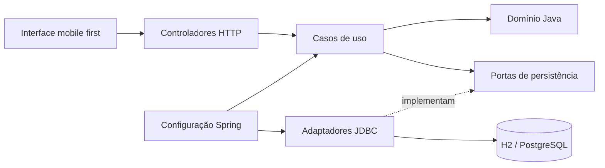

# Arquitetura e decisões

O projeto usa separação por responsabilidade inspirada em Clean Code e Clean Architecture, sem reescrever as regras de negócio em um segundo modelo.

O domínio preserva entidades, enums, validações, eventos e o serviço de estoque originais. O serviço de estoque permanece no mesmo pacote dos agregados para acessar operações internas sem abrir setters públicos. A aplicação usa uma instância desse serviço por operação: a lista de movimentos didática não é tratada como armazenamento definitivo. A fonte de dados é o banco SQL.

Os serviços de aplicação recebem contratos por construtor, coordenam permissões e delimitam transações. Foram usadas anotações Spring nos casos de uso para explicitar o limite transacional; o domínio permanece sem dependências de frameworks, verificado por teste. Não há ciclo aplicação → infraestrutura.

## Estoque consistente

O consumo bloqueia a linha da OS e depois a do material com `SELECT ... FOR UPDATE`. Após validar atribuição, estado, duplicidade, material ativo, quantidade e saldo, grava saldo, item, movimento, auditoria e idempotência. Qualquer falha reverte a transação inteira.

A chave `Idempotency-Key` é obrigatória no consumo e na movimentação manual. Ela é vinculada ao usuário e ao hash do conteúdo. Reenvios idênticos devolvem o mesmo ID; conteúdo diferente com a mesma chave é recusado. O frontend mantém a chave enquanto o formulário está aberto. Após uma perda de resposta, repita sem fechar o formulário; recarregar a página cria uma operação nova, e o histórico deve ser consultado antes de repetir reposições manuais.

A chave primária de `itens_os` impede material duplicado na mesma OS. O projeto original já adotava esse comportamento: a aplicação não inventa edição silenciosa do consumo.

As leituras de listagem carregam os dados existentes sem paginação; essa escolha atende à base local inicial. Bases maiores deverão usar paginação no servidor, consultas resumidas, índices medidos e reduzir o carregamento de agregados/itens por linha.

## Autenticação

Os componentes PBKDF2, sessão opaca, CSRF, bloqueio e troca de senha foram reaproveitados. Credenciais e eventos usam JDBC. Sessões ficam em memória, com limite absoluto de oito horas e inatividade de trinta minutos. Os tokens secretos só são emitidos no login. O token de sessão fica em cookie HttpOnly; CSRF fica em sessionStorage por aba. Uma nova aba pode exigir novo login para obter CSRF.

O sistema serve UI e API na mesma origem. Requisições mutáveis exigem sessão e CSRF; quando presente, o cabeçalho Origin deve corresponder à origem do servidor. O IP vem da conexão, sem confiar em X-Forwarded-For arbitrário. Atrás de proxy, configure origem e repasse confiável antes de abrir acesso externo. Não há CORS amplo.

As assinaturas PNG são validadas por formato, dimensões e presença de traços, armazenadas na mesma transação da conclusão e servidas apenas em rota autenticada. A listagem retorna um indicador de assinatura. Banco, backups e acesso de consulta precisam ser tratados segundo a política da organização.

## Interface

HTML semântico, CSS mobile first e módulos JavaScript nativos. A navegação inferior é a base para celular; a sidebar aparece a partir de 900px. Formulários têm rótulos, foco visível, feedback e botões desabilitados durante envio. Dados de usuário são escapados antes de montar HTML. Scripts e estilos são locais, sem CDN ou fontes externas.

## Evolução recomendada

Antes de escalar, adicionar testes PostgreSQL no CI, sessões e rate limit compartilhados, paginação, recuperação de acesso, políticas de retenção, transações para correção/devolução vinculada à OS e operações de backup/restauração ensaiadas. A autenticação HTTP atual pode ser substituída por um adaptador Spring Security sem alterar as entidades.
