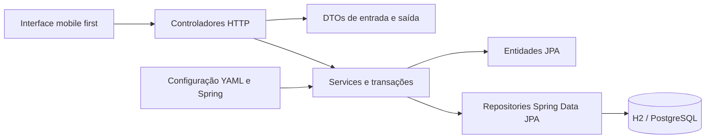

# Arquitetura e decisões

O projeto usa uma estrutura direta por responsabilidade, com controllers REST, services, repositories Spring Data JPA, entidades, DTOs e configuração. Enums e componentes de segurança têm seus próprios pacotes.

`controller` recebe e valida requisições. `service` contém as regras de estoque, OS, contas e autenticação. `repository` contém as interfaces `JpaRepository` e o armazenamento de sessões em memória. `entity` mapeia usuários, materiais, ordens, itens, movimentos, auditoria e idempotência. `dto` define os contratos HTTP. `config` reúne o filtro HTTP, beans de configuração e carga inicial. `enums` reúne todos os enums, inclusive os de segurança; `seguranca` contém PBKDF2, tokens e controle de tentativas.

As dependências são injetadas por construtor. Os services delimitam as transações com `@Transactional`, e o Hibernate acompanha as alterações nas entidades carregadas. As leituras são convertidas em DTOs dentro das transações, com `open-in-view: false`. Os controllers não acessam repositories nem abrem transações. O backend fornece JSON e a interface estática consome a API; não há portas, adaptadores ou templates MVC.

`application.yml` configura o H2 por padrão e `application-postgres.yml` configura o perfil PostgreSQL. No Windows, `scripts/executar.ps1` carrega a conexão e o perfil do `.env` local, verifica a autenticação com `psql` e só solicita a senha inicial quando o banco selecionado não tem usuários. O Flyway 11.20.0 aplica o esquema, incluindo suporte ao PostgreSQL 18, e o Hibernate usa `ddl-auto: validate`. A sequência existente continua gerando os IDs com alocação de um por vez. A V1 permanece intacta e a V2 acrescenta `alvo_id` à auditoria, preservando os dados existentes.

## Estoque consistente

O consumo bloqueia a OS e depois o material usando `@Lock(PESSIMISTIC_WRITE)` nos repositories JPA. Após validar atribuição, estado, duplicidade, material ativo, quantidade e saldo, grava saldo, item, movimento, auditoria e idempotência. Qualquer falha reverte a transação inteira. Os itens são uma coleção JPA da OS, persistida na tabela `itens_os`.

A chave `Idempotency-Key` é obrigatória no consumo e na movimentação manual. Ela é vinculada ao usuário e ao hash do conteúdo. Reenvios idênticos devolvem o mesmo ID; conteúdo diferente com a mesma chave é recusado. O frontend mantém a chave enquanto o formulário está aberto. Após uma perda de resposta, repita sem fechar o formulário; recarregar a página cria uma operação nova, e o histórico deve ser consultado antes de repetir reposições manuais.

A chave primária de `itens_os` impede material duplicado na mesma OS. O projeto original já adotava esse comportamento: a aplicação não inventa edição silenciosa do consumo.

As leituras de listagem carregam os dados existentes sem paginação; essa escolha atende à base local inicial. Bases maiores deverão usar paginação no servidor, consultas resumidas, índices medidos e reduzir o carregamento de agregados/itens por linha.

## Autenticação

Os componentes PBKDF2, sessão opaca, CSRF, bloqueio e troca de senha foram preservados. Usuários, credenciais e eventos são persistidos por JPA. A troca de senha usa atualização condicional para detectar alterações concorrentes. Falhas de login são auditadas antes de recusar a autenticação. Sessões ficam em memória, com limite absoluto de oito horas e inatividade de trinta minutos. Os tokens secretos só são emitidos no login. O token de sessão fica em cookie HttpOnly; CSRF fica em sessionStorage por aba. Uma nova aba pode exigir novo login para obter CSRF.

O sistema serve UI e API na mesma origem. Requisições mutáveis exigem sessão e CSRF; quando presente, o cabeçalho Origin deve corresponder à origem do servidor. O IP vem da conexão, sem confiar em X-Forwarded-For arbitrário. Atrás de proxy, configure origem e repasse confiável antes de abrir acesso externo. Não há CORS amplo.

As assinaturas PNG são validadas por formato, dimensões e presença de traços, armazenadas na mesma transação da conclusão e servidas apenas em rota autenticada. A listagem retorna um indicador de assinatura. Banco, backups e acesso de consulta precisam ser tratados segundo a política da organização.

## Interface

HTML semântico, CSS mobile first e módulos JavaScript nativos. A navegação inferior é a base para celular; a sidebar aparece a partir de 900px. Formulários têm rótulos, foco visível, feedback e botões desabilitados durante envio. Dados de usuário são escapados antes de montar HTML. Scripts e estilos são locais, sem CDN ou fontes externas.

## Evolução recomendada

Os testes operacionais executam em PostgreSQL 18 no CI e podem ser repetidos localmente com `scripts/testar-postgres.ps1`, em um esquema temporário isolado. Antes de escalar, adicionar sessões e rate limit compartilhados, paginação, recuperação de acesso, políticas de retenção, transações para correção/devolução vinculada à OS e operações de backup/restauração ensaiadas.
